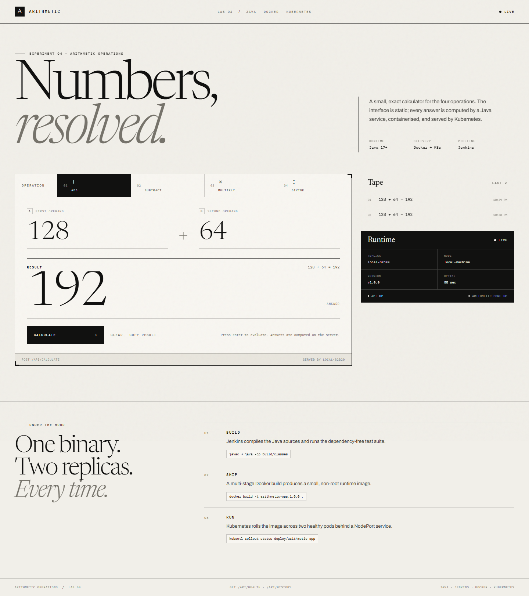

# Arithmetic Operations

A precise, dependency-free Java calculator for addition, subtraction, multiplication and division. Built for **DevOps Lab 04** and delivered end to end with **Git → Jenkins → Docker → Kubernetes**.



## What is inside

| Layer | Implementation |
|---|---|
| Application | Java 17+ (`com.sun.net.httpserver`), HTML/CSS/JS frontend |
| Arithmetic | `BigDecimal` core with decimal division and explicit divide-by-zero handling |
| API | `GET /api/health`, `GET /api/history`, `GET/POST /api/calculate` |
| Build | `javac` + `jar`, no external Java dependencies |
| Tests | Zero-dependency `CalculatorTest` runner (11 tests) |
| Container | Multi-stage Dockerfile, Alpine JRE, non-root UID 10001 |
| Orchestration | Kubernetes Deployment (2 replicas), NodePort Service, probes, resource limits |
| Local cluster | `kind` (`arithmetic-lab`) with host port `30081` |
| CI/CD | Declarative `Jenkinsfile` with compile, test, image, deploy and smoke-test stages |

## Repository layout

```text
Arithmetic-Operations/
├── src/main/java/com/arithmetic/     Calculator.java, App.java
├── src/main/resources/static/        index.html, styles.css, app.js, fonts
├── src/test/java/com/arithmetic/     CalculatorTest.java
├── k8s/                              namespace, deployment, service, kind config
├── scripts/                          build, test, run, deploy, smoke test
├── docs/                             demo runbook, Jenkins notes, screenshots
├── Dockerfile
├── Jenkinsfile
└── README.md
```

## Run locally

Requirements: JDK 17 or newer. No Maven or Gradle is required.

```powershell
cd Arithmetic-Operations
powershell -ExecutionPolicy Bypass -File scripts\build.ps1
powershell -ExecutionPolicy Bypass -File scripts\test.ps1
powershell -ExecutionPolicy Bypass -File scripts\run.ps1
```

Open <http://localhost:8080>.

The UI starts with `128 + 64`; choose an operation, enter two numbers, and press **Enter** or **Calculate**. Each answer comes from the Java API, not from JavaScript. The runtime panel shows the pod that handled the request.

## API

```powershell
# Health / Kubernetes probes
curl.exe http://localhost:8080/api/health

# Calculate (form-encoded)
curl.exe -X POST http://localhost:8080/api/calculate -d "a=144&b=12&op=divide"

# Calculate (query string, useful in a browser)
curl.exe "http://localhost:8080/api/calculate?a=12&b=8&op=multiply"

# History for this replica
curl.exe http://localhost:8080/api/history
```

Supported `op` values: `add`, `subtract`, `multiply`, `divide` (symbols `+ - * /` also work).

Example response:

```json
{
  "a": "144",
  "b": "12",
  "operation": "divide",
  "label": "Division",
  "symbol": "÷",
  "result": "12",
  "expression": "144 ÷ 12 = 12",
  "servedBy": "arithmetic-app-7bc6f965f-4cfp8",
  "at": "2026-11-17T17:13:00Z"
}
```

## Docker

```powershell
docker build -t arithmetic-ops:1.0.0 .
docker run --rm -p 8081:8080 arithmetic-ops:1.0.0
```

Open <http://localhost:8081>.

## Kubernetes with kind

```powershell
kind create cluster --name arithmetic-lab --config k8s\kind-config.yaml
kind load docker-image arithmetic-ops:1.0.0 --name arithmetic-lab
kubectl apply -k k8s
kubectl -n arithmetic set image deployment/arithmetic-app app=arithmetic-ops:1.0.0
kubectl -n arithmetic rollout status deployment/arithmetic-app
kubectl -n arithmetic get pods,svc
```

Open <http://localhost:30081>.

Or run the whole sequence:

```powershell
powershell -ExecutionPolicy Bypass -File scripts\deploy-kind.ps1 -ImageTag 1.0.0
```

The service is a `NodePort` on `30081`, mapped to the kind control-plane container. Two replicas run behind it, with readiness and liveness probes on `/api/health`.

Useful demo commands:

```powershell
kubectl -n arithmetic get pods -o wide
kubectl -n arithmetic get svc arithmetic-service
kubectl -n arithmetic rollout restart deployment/arithmetic-app
kubectl -n arithmetic rollout status deployment/arithmetic-app
kubectl -n arithmetic scale deployment/arithmetic-app --replicas=3
kubectl -n arithmetic logs deployment/arithmetic-app --tail=30
kubectl -n arithmetic delete pod -l app=arithmetic-app
```

## Jenkins

The repository contains a declarative `Jenkinsfile`. The pipeline:

1. Checks out the `main` branch of this repository.
2. Compiles the sources and runs the 11-test suite.
3. Builds `arithmetic-ops:build-<BUILD_NUMBER>` and `arithmetic-ops:latest`.
4. Loads the image into the `arithmetic-lab` kind cluster.
5. Applies the Kubernetes manifests and updates the Deployment image.
6. Waits for the rollout and runs the four-operation smoke test.

Jenkins requirements on Windows:

- Jenkins running on the host (not inside a container) so it can reach Docker Desktop, `kind` and `kubectl`.
- `java`, `javac`, `jar`, `git`, `docker`, `kind` and `kubectl` on `PATH` (the build script also discovers a JDK through `JAVA_HOME`).
- Docker Desktop running.

Create a **Pipeline** job pointing at this repository, branch `*/main`, script path `Jenkinsfile`, then click **Build Now**. See [docs/JENKINS.md](docs/JENKINS.md) for the manual freestyle configuration required by the lab record.

## Notes

- The service keeps the last 12 calculations **per replica** in memory. That is intentional: it makes the pod name in the UI meaningful when Kubernetes load-balances requests.
- Division uses a scale of 10 with `HALF_UP`, so `1 / 3` returns `0.3333333333`.
- The container runs as a non-root user with a read-only root filesystem and a small in-memory `/tmp`.
- No external Java libraries, no database, and no cloud dependency: the demo works offline once the images are present.

## Author

GitHub: [Ksiri03](https://github.com/Ksiri03)
